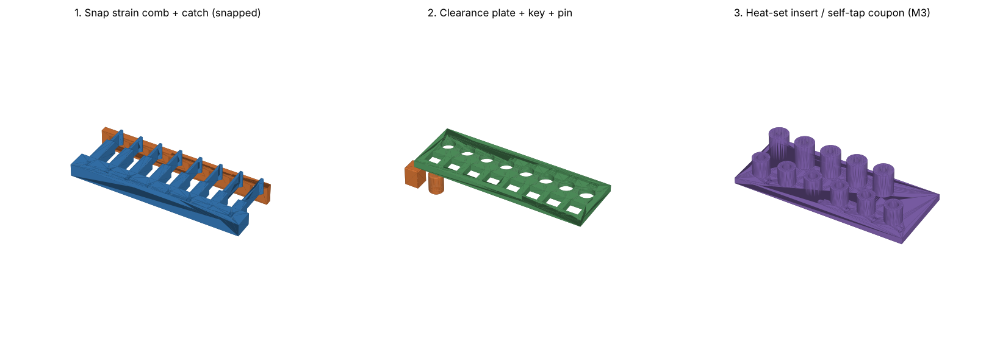

# قطعه‌های تست — اندازه‌گیری عددهای واقعی پرینتر و فیلامنت خودت

این قطعه‌ها عددهایی را می‌دهند که هیچ سایت و راهنمایی نمی‌تواند برای پرینتر تو بدهد. نتیجه‌ها در `results-template.json` ثبت می‌شوند و افزونه آن‌ها را با برچسب `source_type: TEST` (بالاترین اولویت) استفاده می‌کند.

| فایل (پوشه‌ی `out/`) | چه چیزی را اندازه می‌گیرد |
|---|---|
| `snap_strain_comb` + `snap_strain_catch` | کرنش مجاز هوک (یک‌باره و مکرر) — قطعه‌ی خوابیده (خمش در XY) |
| `snap_strain_comb_Z` (اختیاری) | همان، ولی ایستاده → خمش از روی لایه‌ها (Z) — ضریب ناهمسانی |
| `clearance_plate` + `clearance_key_square` + `clearance_pin_round` | لقی مناسب (press / snug / free / loose) برای سوراخ مربعی و گرد |
| `insert_screw_coupon` | بهترین قطر سوراخ مهره‌ی حرارتی M3 و پیش‌سوراخ پیچ مستقیم M3 |

هر قطعه هم STEP (برای SolidWorks) و هم STL (برای اسلایسر) دارد. ابعاد در `out/coupon_parameters.json` است. برای تغییر ابعاد، `make_coupons.py` را ویرایش و دوباره اجرا کن (`pip install cadquery`).

---

## ۱. تنظیمات چاپ — مهم‌ترین قانون

**دقیقاً با همان فیلامنت، رنگ، پرینتر و تنظیماتی چاپ کن که قطعه‌ی اصلی را چاپ می‌کنی.** (Slant 3D: لقی با رنگ، جنس، infill و پرینتر عوض می‌شود.) برای هر فیلامنت جدید (مثلاً PLA و ASA جدا) یک بار تست کن.

| تنظیم | مقدار |
|---|---|
| جهت | همان‌طور که STL است (کف روی بستر). `snap_strain_catch` را روی وجه بزرگش بخوابان (اسلایسر معمولاً خودش می‌کند). کلید و پین ایستاده. |
| ارتفاع لایه | همان قطعه‌ی اصلی (مثلاً 0.2) |
| دیواره | 3، wall generator = **Arachne** (تیرها 1.2 mm هستند) |
| infill | **100%** برای comb و catch؛ بقیه مثل قطعه‌ی اصلی |
| XY hole / contour compensation | **خاموش** (می‌خواهیم خطای واقعی را ببینیم) |
| ساپورت | لازم نیست |
| ASA | با محفظه؛ انقباض فیلامنت را همان مقداری بگذار که برای قطعه‌ی اصلی می‌گذاری |

بعد از چاپ، قطعه‌ها را **حداقل ۲۴ ساعت** در دمای اتاق نگه دار و بعد تست کن (اتمسفر استاندارد آماده‌سازی پلاستیک‌ها در ISO 291؛ ISO 527 هم آن را لازم می‌داند).

---

## ۲. تست کرنش هوک (snap strain comb)

### طراحی
۸ بازو با ضخامت `t = 1.2 mm` و یک هوک یکسان. هر هوک موقع رد شدن از شکافِ catch **دقیقاً 1.0 mm** خم می‌شود (با هندسه چک شد: 0.9 mm کافی نیست). فقط طول بازو فرق می‌کند، پس کرنش ریشه فرق می‌کند:

`ε = 1.5 · y · t / l²` — Bayer Table 1، طرح ۱، مقطع A [V-ORIG]

| بازو | طول l (mm) | کرنش ریشه ε |
|---|---|---|
| 1 | 6.71 | 4.0% |
| 2 | 7.75 | 3.0% |
| 3 | 8.49 | 2.5% |
| 4 | 9.49 | 2.0% |
| 5 | 10.61 | 1.6% |
| 6 | 11.77 | 1.3% |
| 7 | 13.42 | 1.0% |
| 8 | 15.00 | 0.8% |

بقیه‌ی هندسه: زاویه‌ی ورود 30°، زاویه‌ی برگشت 45° (قابل جدا شدن)، فیلت ریشه 0.6 mm (`r/t = 0.5`)، لقی محوری 0.2 mm در حالت بسته (بدون پیش‌بار — چک شد). شماره‌ی بازو روی پشت comb و روی catch حک شده.

### قبل از تست: اندازه بگیر
با کولیس: ضخامت واقعی چند بازو (`t_real`) و ارتفاع واقعی هوک از سطح بازو (`h_real`، طراحی 1.25). کرنش واقعی:

`ε_real = 1.5 · (h_real − 0.25) · t_real / l²`

(اگر عددها با طراحی بیش از ~0.05 mm فرق داشتند، جدول را با این فرمول دوباره حساب کن.)

### روش — تست یک‌باره
از **بازوی ۸** (کمترین کرنش) شروع کن و به سمت ۱ برو. هر بازو را **مستقیم در امتداد طولش** در شکاف همان شماره فشار بده تا «کلیک» کند (از کنار وارد نکن). بعد بیرون بکش. نتیجه:

| کد | یعنی |
|---|---|
| `OK` | سالم، کاملاً به حالت اول برمی‌گردد |
| `WHITE` | سفید شدن ریشه (stress whitening — در ASA واضح‌تر) |
| `SET` | کمی خم مانده (تغییر شکل دائمی) — با خط‌کش لبه‌ی صاف کنار بازو چک کن |
| `CRACK` | ترک در ریشه یا بین لایه‌ها |
| `BREAK` | شکست |

**ε_once = بیشترین کرنشی که `OK` بود.**

### روش — تست مکرر
روی بازوهایی که `OK` بودند، هر کدام **۱۰ بار** جا بزن و دربیاور. **ε_repeat = بیشترین کرنشی که بعد از ۱۰ بار هنوز `OK` است.** (پیش‌بینی Bayer: ≈ 60% ε_once — با تست تو مقایسه می‌شود.)

### اختیاری — نسخه‌ی Z
`snap_strain_comb_Z` را ایستاده چاپ کن (همان‌طور که در STL است، بازوها رو به بالا) و همین تست را تکرار کن. نسبت `ε_once(Z) / ε_once(XY)` = ضریب ناهمسانی برای پرینتر و فیلامنت تو (منابع: ۲۵–۵۰%). ⚠️ انتظار شکست ترد داری — عینک بزن.

### چطور در افزونه استفاده می‌شود
افزونه عدد آستانه را مستقیم استفاده نمی‌کند: `ε_allow = ε_once / SF` با `SF ≥ 1.5`، و برای باز و بسته‌ی مکرر کمترِ `ε_repeat / SF` و `0.6 · ε_once / SF`.
این تست go/no-go است، نه تست کشش ISO 527؛ در گزارش افزونه با برچسب `TEST` (تست کاربر) ثبت می‌شود.

---

## ۳. تست لقی (clearance plate)

صفحه ۸ سوراخ مربعی و ۸ سوراخ گرد دارد برای کلید/پین اسمی 10 mm؛ لقی **هر طرف**: 0.10، 0.15، 0.20، 0.25، 0.30، 0.40، 0.50، 0.60 mm (روی صفحه حک شده). لبه‌ی پایین همه‌ی سوراخ‌ها 0.4 mm پخ دارد (ضد elephant's foot).

کلید مربعی و پین گرد را در هر سوراخ امتحان کن (از **رو** وارد کن، نه از کف):

| کد | یعنی |
|---|---|
| `NO` | وارد نمی‌شود |
| `PRESS` | فقط با فشار زیاد |
| `SNUG` | با اصطکاک می‌لغزد، بدون لقی |
| `FREE` | آزاد می‌لغزد، لقی کم |
| `LOOSE` | لق می‌زند |

افزونه این‌طور استفاده می‌کند:
- **press fit** → لقی ستون `PRESS`
- **لقی Lip/Groove و dovetail** → کوچک‌ترین `FREE` (مربعی — چون لبه‌ها گوشه دارند)
- **لقی snap fit** → کوچک‌ترین `FREE`
- **پین و لولا** → کوچک‌ترین `FREE` (گرد)

---

## ۴. تست مهره‌ی حرارتی و پیچ مستقیم (M3)

**ردیف جلو — مهره‌ی حرارتی M3×5.7** (قطر بیرونی ~4.6): سوراخ CAD ‏3.9، 4.0، 4.1، 4.2، 4.3، 4.4 mm، عمق 6.7 (= L + 1)، بوس Ø8. CNC Kitchen پیش‌بینی می‌کند **4.2 در CAD** (≈ 4.0 واقعی) بهترین است.
- هویه: دمای چاپ + 10–20°C (PLA ~225، ASA ~265). ۹۰٪ را با گرما فرو کن، بقیه را با فشار صاف.
- ثبت کن: صاف نشست؟ پلاستیک بیرون زد؟ با پیچ M3 سفت کن — چرخید یا بیرون آمد؟ **بهترین قطر = صاف، بدون بیرون‌زدگی، نچرخید.**

**ردیف عقب — پیچ مستقیم M3**: پیش‌سوراخ 2.5، 2.6، 2.7، 2.8، 2.9 mm، عمق 10، بوس Ø9. CNC Kitchen: 2.7 تست شده.
- پیچ M3 را بپیچان. ثبت کن: `HARD` (خیلی سفت/بوس ترک خورد)، `GOOD`، `STRIP` (زود هرز شد).
- ⚠️ پیچ مستقیم در PLA در ~1 Nm هرز می‌شود (CNC Kitchen) — برای چند بار باز و بسته، مهره‌ی حرارتی.

---

## ۵. ثبت نتیجه

فایل `results-template.json` را کپی کن (مثلاً `results-PLA-elegoo-black.json`) و پر کن. افزونه این فایل را می‌خواند.
